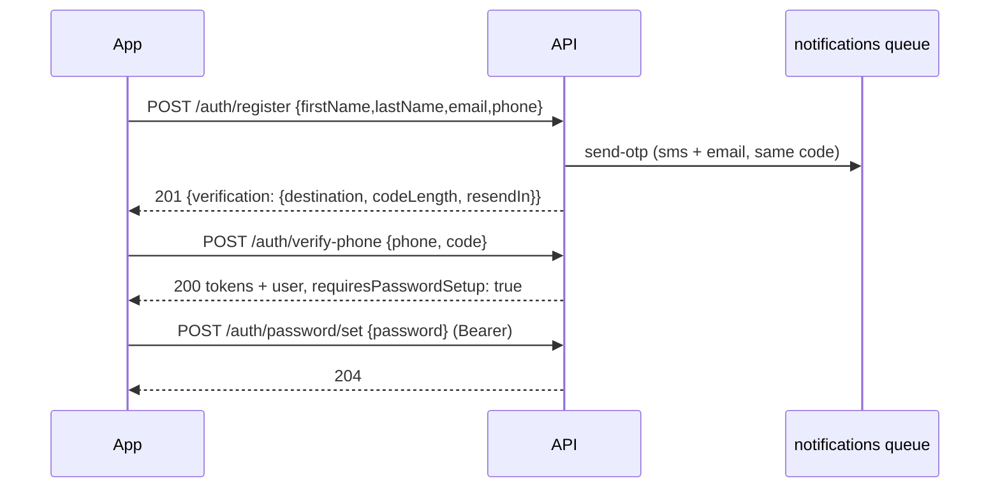
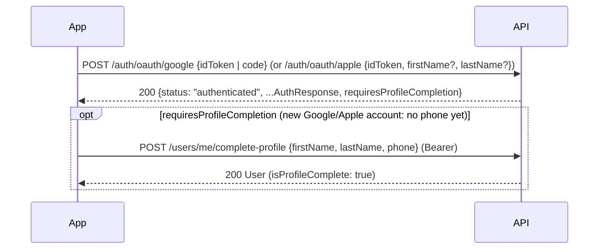
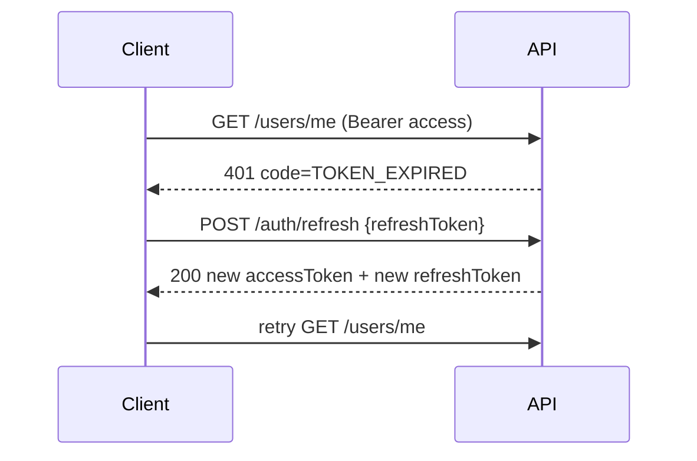

# Authentication

How sign-up, login and sessions work in the Gbanjo API, for anyone building a client (mobile, web) or changing the backend.

Interactive reference with request/response schemas: **`http://localhost:4000/api/docs`** (OpenAPI JSON at `/api/docs-json`).

---

## At a glance

| | |
| --- | --- |
| Base URL | `http://localhost:4000/api/v1` |
| Identity | Email + password, or Google / Apple — phone always verified by SMS code |
| Access token | JWT (HS256), 15 min, sent as `Authorization: Bearer <token>` |
| Refresh token | Opaque `<sessionId>.<secret>`, 30 days, **single-use** (rotates on every refresh) |
| Passwords | Argon2id, 8–72 chars with at least one letter and one number |
| One-time codes | 4 digits (configurable), 10 min, max 5 wrong tries, kept only in Redis (hashed) |
| Delivery | SMS / email go through the BullMQ `notifications` queue |

## Architecture

```
src/
├─ common/                 decorators (@Public, @CurrentUser, @Client), error filter, validation, crypto/phone utils
├─ config/                 env validation (zod), Swagger, Redis options
├─ prisma/  redis/  queue/ infrastructure modules (Prisma + pg adapter, ioredis, BullMQ root)
└─ modules/
   ├─ auth/
   │  ├─ auth.controller.ts     HTTP routes only — no logic
   │  ├─ auth.service.ts        sign-up, login, refresh, password flows
   │  ├─ services/
   │  │  ├─ token.service.ts    sessions, JWTs, refresh rotation + reuse detection
   │  │  ├─ otp.service.ts      codes in Redis: cooldown, hourly cap, attempt limit
   │  │  ├─ password.service.ts Argon2id hash/verify (constant-time for unknown users)
   │  │  └─ login-attempts.service.ts  lockout after repeated wrong passwords
   │  ├─ strategies/jwt.strategy.ts  verifies the JWT and that its session is still live
   │  ├─ guards/jwt-auth.guard.ts    global guard; opt out with @Public()
   │  └─ dto/                        class-validator request DTOs + Swagger response DTOs
   ├─ users/                 GET/PATCH /users/me, UserResponseDto (never exposes the hash)
   └─ notifications/         queue producer, BullMQ processor, SMS/email channel interfaces
```

Request pipeline: **helmet → CORS → ThrottlerGuard (Redis) → JwtAuthGuard → ValidationPipe → controller → service**. Any error is turned into the standard error body by `AllExceptionsFilter`.

### Data

- `users` — `email` (lower-case, unique), `phone` (E.164, unique), `password_hash` (nullable), `phone_verified_at`, `role`, `status`.
- `sessions` — one row per signed-in device: `token_hash` (SHA-256 of the refresh secret), `previous_token_hash`, `expires_at`, `revoked_at`, `revoked_reason`, `user_agent`, `ip_address`.
- Redis — `otp:*` (codes, cooldowns, send counters), `login:*` (failed attempts, locks), `pwreset:*` (reset tokens), `throttler:*` (rate limits). Nothing in Redis is needed long-term.

---

## Flows

### Sign-up (mobile)

The mobile sign-up screen has no password field, so the password is created after the phone is verified.



### Sign-up (web)

Same as above, but the web form sends `password` with `/auth/register`, so `verify-phone` returns `requiresPasswordSetup: false`.

Re-registering with the email/phone of an account that **hasn't** been verified updates that account and sends a fresh code (so a typo or a lost SMS isn't a dead end). A verified email/phone gives `409 EMAIL_TAKEN` / `PHONE_TAKEN`.

### Google / Apple sign-in

The client gets a token from Google or Apple and sends it to the API, which verifies it against the provider's signing keys (signature, issuer, audience, expiry). **There is no SMS code**: the provider has already proved who the user is, so the response always signs the user in.



- **New user:** the account is created on the spot with the provider-verified email, a 0.00 wallet and **no phone**. `requiresProfileCompletion: true` → send them to the complete-profile screen. The phone they add there is saved without an SMS code.
- **Existing account with the same email:** linked and signed in. If that account was an unfinished sign-up (phone never verified, no Google/Apple link), whoever started it never proved anything, so its password and phone are wiped and the provider-verified owner takes it over.
- **Passwords:** social users don't need one (`requiresPasswordSetup: false`). They can add one with forgot password (the code goes to their email while they have no phone).
- **Web:** the Google popup returns an authorization code (`redirect_uri=postmessage`); the API exchanges it using `GOOGLE_CLIENT_SECRET`. **Mobile** sends the ID token from the native SDK, issued for the web client ID (`webClientId`).
- Linked identities are stored in `oauth_accounts` (provider + the provider's `sub`).

### Wallet

Every account gets a wallet with balance **0.00 NGN** when it's created (phone sign-up or Google/Apple). `GET /wallet` returns `{balance: "0.00", currency: "NGN", updatedAt}` — the balance is a string with two decimals so no precision is lost.

### Login

1. *(optional, mobile)* `POST /auth/lookup {email}` → `{firstName, avatarUrl, maskedPhone, maskedEmail}` to greet the user on the password screen.
2. `POST /auth/login {email, password}` → tokens + user.
   - `401 INVALID_CREDENTIALS` with `details.attemptsRemaining`.
   - `429 ACCOUNT_LOCKED` with `details.retryAfter` (seconds) after `LOGIN_MAX_ATTEMPTS` failures.
   - `403 PHONE_NOT_VERIFIED` — a new code has been sent; continue with `/auth/verify-phone` using `details.phone`.

### Staying signed in



Rules for clients:

- **Store the new refresh token every time** — the old one stops working.
- Refresh **once** and queue other requests until it finishes. A token reused within 20 s returns `401 TOKEN_ROTATED` (harmless — use the newest token). A token reused later is treated as stolen: the whole session is revoked.
- On `INVALID_REFRESH_TOKEN`, clear tokens and send the user to login.

### Forgot password

1. `POST /auth/password/forgot {email, channel: "sms" | "email"}` → always `202` with the same body (doesn't reveal whether the email has an account).
2. `POST /auth/password/verify-code {email, code}` → `{resetToken, expiresIn: 900}`.
3. `POST /auth/password/reset {resetToken, password}` → `204`. Every session is revoked and an email confirms the change.

### Signed-in password changes

- `POST /auth/password/change {currentPassword, newPassword}` → `204`; other devices are signed out, this one stays signed in.
- `POST /auth/password/set {password}` → only for accounts without a password (`409 PASSWORD_ALREADY_SET` otherwise).

### Logout

- `POST /auth/logout {refreshToken}` → `204`; revokes that device. Access tokens for the session stop working immediately (the JWT guard checks the session).
- `POST /auth/logout-all` (Bearer) → `204`; every device.

---

## Endpoints

All paths are relative to `/api/v1`.

| Method | Path | Auth | Body | Success |
| --- | --- | --- | --- | --- |
| POST | `/auth/register` | – | `firstName, lastName, email, phone, password?` | 201 `{message, verification}` |
| POST | `/auth/oauth/google` | – | `idToken` (mobile) or `code` (web) | 200 `{status, ...AuthResponse}` |
| POST | `/auth/oauth/apple` | – | `idToken, firstName?, lastName?` | 200 `{status, ...AuthResponse}` |
| POST | `/auth/verify-phone` | – | `phone, code` | 200 `AuthResponse` |
| POST | `/auth/resend-otp` | – | `phone` | 200 `Verification` |
| POST | `/auth/lookup` | – | `email` | 200 `{firstName, avatarUrl, maskedPhone, maskedEmail}` |
| POST | `/auth/login` | – | `email, password` | 200 `AuthResponse` |
| POST | `/auth/refresh` | – | `refreshToken` | 200 `AuthResponse` |
| POST | `/auth/logout` | – | `refreshToken` | 204 |
| POST | `/auth/logout-all` | Bearer | – | 204 |
| POST | `/auth/password/forgot` | – | `email, channel` | 202 `{message, codeLength, resendIn}` |
| POST | `/auth/password/verify-code` | – | `email, code` | 200 `{resetToken, expiresIn}` |
| POST | `/auth/password/reset` | – | `resetToken, password` | 204 |
| POST | `/auth/password/set` | Bearer | `password` | 204 |
| POST | `/auth/password/change` | Bearer | `currentPassword, newPassword` | 204 |
| GET | `/users/me` | Bearer | – | 200 `User` |
| PATCH | `/users/me` | Bearer | `firstName?, lastName?, email?, avatarUrl?` | 200 `User` |
| POST | `/users/me/complete-profile` | Bearer | `firstName, lastName, phone` | 200 `User` (409 `PHONE_TAKEN` / `PHONE_LOCKED`) |
| GET | `/wallet` | Bearer | – | 200 `{balance, currency, updatedAt}` |
| GET | `/health` *(at `/api/health`)* | – | – | 200 `{status, database, redis}` |

`phone` accepts `0904…`, `904…`, `234904…` or `+234904…`; the API stores and returns `+234…`. Phone numbers can't be changed through `PATCH /users/me`; a Google/Apple account without one adds it with `POST /users/me/complete-profile`. `phone` is `null` until then.

### AuthResponse

```json
{
  "tokenType": "Bearer",
  "accessToken": "eyJhbGciOiJIUzI1NiIs…",
  "accessTokenExpiresIn": 900,
  "refreshToken": "cmv39j26c0001p47dzuiy0ztt.K-isQROWVXQE9LNPBBNUXYc2xPJjx25utLmM6EkcBh8",
  "refreshTokenExpiresAt": "2026-11-10T03:27:46.881Z",
  "requiresPasswordSetup": false,
  "requiresProfileCompletion": false,
  "user": {
    "id": "cmv39j24q0000p47d0po88mnr",
    "firstName": "Romina",
    "lastName": "Williams",
    "email": "romina@email.com",
    "phone": "+2349045654356",
    "avatarUrl": null,
    "role": "USER",
    "isPhoneVerified": true,
    "isEmailVerified": false,
    "hasPassword": true,
    "isProfileComplete": true,
    "createdAt": "2026-10-11T03:27:46.000Z"
  }
}
```

### Verification

```json
{ "channel": "sms", "destination": "+234********56", "codeLength": 4, "expiresIn": 600, "resendIn": 60 }
```

---

## Errors

Every error has the same shape:

```json
{
  "statusCode": 401,
  "error": "Unauthorized",
  "code": "INVALID_CREDENTIALS",
  "message": "Email or password is incorrect.",
  "details": { "attemptsRemaining": 2 },
  "path": "/api/v1/auth/login",
  "timestamp": "2026-10-11T03:27:46.858Z"
}
```

Switch on `code`; show `message` (written for end users). Validation errors carry per-field messages in `details.fields`.

| Status | Code | When | `details` |
| --- | --- | --- | --- |
| 400 | `VALIDATION_FAILED` | Bad or missing fields, unknown fields | `fields: {name: message}` |
| 400 | `INVALID_PHONE` | Not a Nigerian mobile number | `fields.phone` |
| 400 | `INVALID_CODE` | Wrong OTP | `attemptsRemaining` |
| 400 | `CODE_EXPIRED` | OTP expired / used / never sent | |
| 400 | `INVALID_RESET_TOKEN` | Reset token expired or already used | |
| 400 | `INVALID_PASSWORD` | Wrong current password on change | `fields.currentPassword` |
| 400 | `PASSWORD_UNCHANGED` | New password equals the current one | `fields.newPassword` |
| 401 | `UNAUTHORIZED` | Missing/invalid access token, or its session was revoked | |
| 401 | `TOKEN_EXPIRED` | Access token expired → refresh | |
| 401 | `INVALID_CREDENTIALS` | Wrong email/password | `attemptsRemaining` |
| 401 | `INVALID_REFRESH_TOKEN` | Refresh token unknown, expired, revoked or reused | |
| 401 | `TOKEN_ROTATED` | Refresh token was rotated seconds ago (parallel refresh) | |
| 403 | `PHONE_NOT_VERIFIED` | Login before verifying the phone (new code sent) | `phone, verification` |
| 403 | `ACCOUNT_SUSPENDED` | Account disabled | |
| 404 | `ACCOUNT_NOT_FOUND` | Lookup / resend for an unknown account | |
| 409 | `EMAIL_TAKEN` / `PHONE_TAKEN` | Already used by a verified account | |
| 409 | `ALREADY_VERIFIED` | Verifying/resending for a verified phone | |
| 409 | `PASSWORD_ALREADY_SET` | `/password/set` when a password exists | |
| 429 | `ACCOUNT_LOCKED` | Too many wrong passwords | `retryAfter` |
| 429 | `TOO_MANY_ATTEMPTS` | Too many wrong codes (request a new one) | |
| 429 | `OTP_COOLDOWN` | Asked for another code too soon | `retryAfter` |
| 429 | `OTP_LIMIT_REACHED` | Hourly code limit | `retryAfter` |
| 429 | `TOO_MANY_REQUESTS` | Per-IP rate limit | |

---

## Security measures

- Argon2id with OWASP parameters; failed logins for unknown emails still run a hash so timing doesn't reveal accounts.
- Refresh tokens are random 256-bit secrets, stored only as SHA-256, rotated on every use, with reuse detection that revokes the session.
- The JWT guard checks the session on every request, so logout, password reset and suspension take effect immediately.
- OTPs: cryptographically random, stored as a keyed hash in Redis, expire after 10 minutes, die after 5 wrong tries, 60 s resend cooldown and 5 sends/hour.
- Brute force: account lock after 5 wrong passwords (15 min) plus per-IP limits (10/min on auth routes, 120/min elsewhere), counted in Redis so they hold across instances.
- `forgot-password` never reveals whether an email is registered. `lookup` necessarily does (the two-step mobile login needs it), so it's rate-limited.
- Validation strips unknown fields and rejects them (`forbidNonWhitelisted`); responses never include password hashes.
- `helmet` security headers, CORS restricted to `CORS_ORIGINS`, Swagger off in production unless `SWAGGER_ENABLED=true`.
- `OTP_DEV_CODE` is refused at startup when `NODE_ENV=production`.

## Configuration

| Variable | Default | Notes |
| --- | --- | --- |
| `JWT_ACCESS_SECRET` | – | **Required**, 32+ chars. `node -e "console.log(require('crypto').randomBytes(48).toString('base64url'))"` |
| `JWT_ACCESS_TTL_SECONDS` | 900 | |
| `REFRESH_TOKEN_TTL_DAYS` | 30 | |
| `LOGIN_MAX_ATTEMPTS` / `LOGIN_LOCK_MINUTES` | 5 / 15 | |
| `OTP_LENGTH` | 4 | Matches the 4-box code screens |
| `OTP_TTL_SECONDS` | 600 | |
| `OTP_MAX_ATTEMPTS` | 5 | |
| `OTP_RESEND_COOLDOWN_SECONDS` | 60 | |
| `OTP_MAX_SENDS_PER_HOUR` | 5 | |
| `OTP_DEV_CODE` | – | Dev only: fixed code (e.g. `1234`) |
| `GOOGLE_CLIENT_ID` | – | Google Cloud OAuth **Web application** client ID. Unset → `503 OAUTH_NOT_CONFIGURED` |
| `GOOGLE_CLIENT_SECRET` | – | Same client's secret; needed for the web popup's code exchange |
| `APPLE_CLIENT_IDS` | `com.gbanjo.app` | Comma-separated audiences: iOS bundle ID, plus the Services ID if Apple sign-in is used on the web |
| `EMAIL_HOST` / `EMAIL_PORT` / `EMAIL_SECURE` | – / 587 / auto | SMTP server (e.g. `smtp.gmail.com`). `EMAIL_SECURE` defaults to true only on port 465 |
| `EMAIL_SERVICE` | – | Instead of a host: a nodemailer service name such as `gmail` |
| `EMAIL_HOST_USER` / `EMAIL_HOST_PASSWORD` | – | SMTP login (for Gmail use an App Password). Without them emails are only printed in the log |
| `EMAIL_FROM` | `Gbanjo <EMAIL_HOST_USER>` | Sender |
| `CORS_ORIGINS` | `http://localhost:3000` | Comma-separated |
| `TRUST_PROXY` | false | Set behind a load balancer so rate limits see real IPs |

## SMS and email

`NotificationsModule` binds `SmsChannel` and `EmailChannel` to console implementations, so in development codes are printed in the API log:

```
[SMS] → +2349045654356: Your Gbanjo code is 1234. Use it to verify your phone number…
```

To go live, write a class that extends `SmsChannel` (e.g. Termii) or `EmailChannel` (e.g. Resend/SES) and swap it in `notifications.module.ts`. Jobs retry 3 times with backoff.

## Tests

```bash
npm test            # unit tests
npm run test:e2e    # full auth flows against Postgres + Redis
```

The e2e suite uses a separate database (`TEST_DATABASE_URL`, default: your `DATABASE_URL` with `_test` appended) and Redis DB 15, and wipes both before each test. Create the database once: `CREATE DATABASE gbanjo_test OWNER gbanjo;`.
