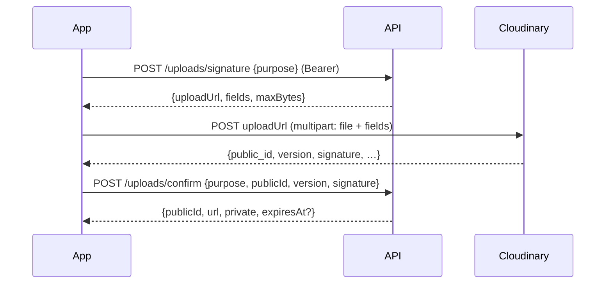

# Image uploads (Cloudinary)

Images go **straight from the browser/app to Cloudinary**; the API only signs the upload and checks the result. The Cloudinary API secret never leaves the server and image bytes never pass through it.



| Purpose | Folder | Visibility |
| --- | --- | --- |
| `listing_photo` | `<CLOUDINARY_FOLDER>/listings/<userId>` | Public URL (auto format + quality) |
| `id_document` | `<CLOUDINARY_FOLDER>/id-documents/<userId>` | **Private** (`authenticated`): only a signed link that expires after 1 hour |
| `avatar` | `<CLOUDINARY_FOLDER>/avatars/<userId>` | Public URL — save it with `PATCH /users/me {avatarUrl}` |

- Every signature is tied to the signed-in user's own folder; `confirm` re-checks Cloudinary's response signature and the folder, so a user can't claim someone else's (or a forged) image.
- `PATCH /users/me` only accepts an `avatarUrl` from the user's own avatars folder (`400 INVALID_AVATAR` otherwise); `null` clears it.
- `DELETE /uploads {purpose, publicId}` removes one of your images (204).
- Allowed formats: jpg, jpeg, png, webp, heic. Max 10 MB (clients also downscale before uploading).
- Without Cloudinary settings, the endpoints answer `503 UPLOADS_NOT_CONFIGURED` (the web app then keeps photos in the browser like before).

## Setup

1. Create a free account at cloudinary.com → **Settings → API Keys**.
2. In `backend/.env`:
   ```
   CLOUDINARY_CLOUD_NAME=your-cloud-name
   CLOUDINARY_API_KEY=123456789012345
   CLOUDINARY_API_SECRET=…
   CLOUDINARY_FOLDER=gbanjo        # e.g. gbanjo-dev for development
   ```
   (or the single `CLOUDINARY_URL=cloudinary://<key>:<secret>@<cloud name>` from the dashboard).
3. Restart the API.
